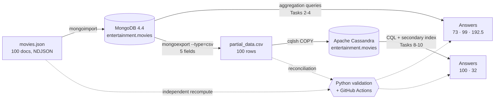

# 🎬 NoSQL Data Pipeline: MongoDB → CSV → Cassandra

[](https://github.com/SaBuMa/nosql-mongodb-cassandra-pipeline/actions/workflows/validate.yml)


A movies dataset moved across two NoSQL databases, a **document store** (MongoDB) and a **wide-column store** (Apache Cassandra), with every answer **independently verified**, the data **reconciled** at both ends, and its **data quality issues** profiled and documented.

> Final project of the **IBM "Introduction to NoSQL Databases"** course (Coursera, IBM Data Engineering Professional Certificate), extended with a Python validation layer, automated CI and a data quality report.

---

## 📌 Highlights

- **10 tasks** across MongoDB and Cassandra: import, aggregation, export, keyspace and table design, bulk load, secondary index
- **Cross-system reconciliation**: the `rating = 'G'` count matches in both databases (32 = 32), and every exported value matches its source
- **Independent validation** in plain Python recomputes every answer without any database: **15/15 checks**, **15/15 unit tests**, run on every push by **GitHub Actions**
- **Data quality report**: 6 documented issues, including a global find-and-replace (`id` → `_id`) that corrupted **35 records** and traveled through every stage of the pipeline
- **Documented design decisions**: replication factor, identifier naming, column types, index trade-offs

---

## 🏗️ Architecture



---

## 🧰 Tech Stack

| Layer | Tools |
|---|---|
| Document database | MongoDB 4.4 · `mongosh` · `mongoimport` / `mongoexport` (Database Tools) |
| Wide-column database | Apache Cassandra · `cqlsh` · CQL |
| Scripting | Bash |
| Validation & testing | Python 3.12 (standard library) · pytest |
| CI | GitHub Actions |
| Environment | IBM Skills Network cloud lab (single-node MongoDB and Cassandra) |

---

## 📂 Repository Structure

```
nosql-mongodb-cassandra-pipeline/
├── .github/workflows/
│   └── validate.yml                    # CI: tests + validation on every push
├── data/
│   ├── movies.json                     # Source dataset (100 movies, NDJSON)
│   └── partial_data.csv                # Exported from MongoDB, loaded into Cassandra
├── scripts/
│   ├── 00_setup_tools.sh               # Download + verify mongoimport/mongoexport
│   ├── mongodb/
│   │   ├── 01_import_movies.sh         # Task 1
│   │   ├── 02_queries.js               # Tasks 2-4 (with cross-checks)
│   │   └── 03_export_partial_data.sh   # Task 5 (with file verification)
│   └── cassandra/
│       ├── 01_create_keyspace.cql      # Task 6
│       ├── 02_create_table_and_import.cql  # Task 7
│       └── 03_queries_and_index.cql    # Tasks 8-10
├── validation/
│   └── validate.py                     # Recompute answers, reconcile, profile
├── tests/
│   └── test_validate.py                # 15 unit tests
├── docs/
│   ├── data_quality_report.md          # 6 issues, evidence, impact, fixes
│   ├── mongodb_vs_cassandra.md         # Concepts + design decisions
│   └── validation_and_ci_explained.md  # How the validation and CI work
├── requirements.txt
├── LICENSE
└── README.md
```

---

## ✅ Results

| # | Task | Database | Result | Verified by |
|---|---|---|---|---|
| 1 | Import `movies.json` into `entertainment.movies` | MongoDB | **100** documents | `countDocuments()` + Python |
| 2 | Year with the most movies | MongoDB | **2016** (73 movies) | `countDocuments({year: 2016})` + Python |
| 3 | Movies released after 1999 | MongoDB | **99** | `countDocuments` + `$match`/`$count` + Python |
| 4 | Average votes for 2007 movies | MongoDB | **192.5** | by hand (2 movies: 160, 225) + Python |
| 5 | Export 5 fields to `partial_data.csv` | MongoDB | **100** rows + header | `head`, `wc -l`, reconciliation |
| 6 | Create keyspace `entertainment` | Cassandra | `SimpleStrategy`, RF 1 | `DESCRIBE KEYSPACE` |
| 7 | Create table + import CSV | Cassandra | **100** rows, 0 skipped | `SELECT COUNT(*)` |
| 8 | Count rows | Cassandra | **100** | Python |
| 9 | Secondary index on `rating` | Cassandra | `rating_index` | `DESCRIBE TABLE` |
| 10 | Movies rated `'G'` | Cassandra | **32** | MongoDB (32) + Python |

---

## 🍃 Part 1: MongoDB

### Setup

```bash
source scripts/00_setup_tools.sh
```

The script **prepends** the tools folder to `PATH`. While building this project, the lab already had `mongoimport` 100.19.0 preinstalled in an earlier `PATH` directory, which shadowed the downloaded 100.3.1. `which mongoimport` and `--version` exposed it.

### Task 1: Import

```bash
export MONGO_USER=root            # credentials via environment, never hardcoded
export MONGO_PASSWORD='...'
bash scripts/mongodb/01_import_movies.sh
```

```text
connected to: mongodb://mongo/
100 document(s) imported successfully. 0 document(s) failed to import.
```

Verified from the database side:

```javascript
use entertainment
db.movies.countDocuments()          // 100
```

Because every document carries an explicit `_id`, the import is **idempotent**: re-running it is rejected with `E11000` duplicate key errors instead of silently creating 200 documents.

### Task 2: Year with the most movies

```javascript
db.movies.aggregate([
  { $group: { _id: "$year", movie_count: { $sum: 1 } } },
  { $sort:  { movie_count: -1 } },
  { $limit: 3 }
])
```

```text
[ { _id: 2016, movie_count: 73 },
  { _id: 2015, movie_count: 8 },
  { _id: 2014, movie_count: 5 } ]
```

### Task 3: Movies released after 1999

```javascript
db.movies.countDocuments({ year: { $gt: 1999 } })                         // 99
db.movies.aggregate([{ $match: { year: { $gt: 1999 } } }, { $count: "n" }]) // { n: 99 }
```

### Task 4: Average votes in 2007

```javascript
db.movies.aggregate([
  { $match: { year: 2007 } },
  { $group: { _id: "$year", averageVotes: { $avg: "$Votes" } } }
])
```

```text
[ { _id: 2007, averageVotes: 192.5 } ]
```

Only **two** documents are behind this average (160 and 225 votes), and both look suspicious. See the [data quality report](docs/data_quality_report.md#5-values-that-are-the-right-type-but-wrong-meaning).

### Task 5: Export to CSV

```bash
bash scripts/mongodb/03_export_partial_data.sh
```

```text
connected to: mongodb://mongo/
exported 100 records
```

The file was verified (header + 100 rows), and reconciled against the source by the validation layer.

---

## 👁️ Part 2: Cassandra

### Task 6: Keyspace

```sql
CREATE KEYSPACE entertainment
WITH replication = {'class': 'SimpleStrategy', 'replication_factor': 1};
```

```text
CREATE KEYSPACE entertainment WITH replication = {'class': 'SimpleStrategy', 'replication_factor': '1'}  AND durable_writes = true;
```

**Why RF 1:** the lab cluster has one node, and the replication factor must not exceed the number of nodes. RF 3 only produced a warning (`Your replication factor 3 for keyspace entertainment is higher than the number of nodes 1`): no real copies, and QUORUM operations would fail. Production would use RF 3.

### Task 7: Table and import

```sql
CREATE TABLE movies (
    id text PRIMARY KEY, title text, year text, rating text, director text
);

COPY entertainment.movies (id, title, year, rating, director)
FROM 'partial_data.csv' WITH DELIMITER = ',' AND HEADER = TRUE;
```

```text
Processed: 100 rows; Rate: 79 rows/s; Avg. rate: 131 rows/s
100 rows imported from 1 files in 0.765 seconds (0 skipped).
```

```text
 id | director          | rating  | title                                        | year
----+-------------------+---------+----------------------------------------------+------
  6 |       Yimou Zhang | unrated |                               The Great Wall | 2016
 90 |    Gavin O'Connor | unrated |                               The Accountant | 2016
 46 |      Rob Marshall | unrated | Pirates of the Caribbean: On Stranger T_ides | 2007
 55 | Christopher Nolan |       G |                              The Dark Knight | 2008
 81 | Christopher Nolan |       G |                                    Inception | 2010
```

Rows come back in **token order** (the hash of the partition key), not id order. That's how Cassandra spreads data evenly across nodes. Also notice `T_ides`: the upstream corruption survived every stage.

### Tasks 8-10: Count, index, filtered count

```sql
SELECT COUNT(*) FROM entertainment.movies;                          -- 100

CREATE INDEX IF NOT EXISTS rating_index ON entertainment.movies (rating);

SELECT COUNT(*) FROM entertainment.movies WHERE rating = 'G';       -- 32
```

```text
Warnings :
Aggregation query used without partition key
```

Without the index, Cassandra refuses `WHERE rating = 'G'` unless you opt in with `ALLOW FILTERING`. The index is local to each node, so the query still asks every node, hence the warning.

### 🔁 Cross-system reconciliation

```text
MongoDB:    db.movies.countDocuments({ rating: "G" })              → 32
Cassandra:  SELECT COUNT(*) FROM movies WHERE rating = 'G';        → 32
Python:     count_rating(json) == count_rating(csv)                → 32
```

---

## 🧪 Validation & CI

[`validation/validate.py`](validation/validate.py) is a **second, independent witness**: it recomputes every answer from the source files with plain Python, reconciles the CSV against the JSON (row counts, missing or extra ids, every field value), and profiles the data quality issues.

```bash
pip install -r requirements.txt
pytest -v                          # 15 unit tests
python validation/validate.py      # 15 checks + data quality profile
```

```text
[MongoDB]
  PASS  Task 1 - documents imported                   expected=100      actual=100
  PASS  Task 2 - year with most movies                expected=2016     actual=2016
  PASS  Task 2 - movies in that year                  expected=73       actual=73
  PASS  Task 3 - movies after 1999                    expected=99       actual=99
  PASS  Task 4 - average votes in 2007                expected=192.5    actual=192.5
[Cassandra]
  PASS  Task 5/7 - CSV rows exported and imported     expected=100      actual=100
  PASS  Task 8 - row count                            expected=100      actual=100
  PASS  Task 10 - movies rated 'G'                    expected=32       actual=32
[Reconciliation]
  PASS  ... 7 checks ...
 15/15 checks passed
```

GitHub Actions runs the tests and the validation on every push and pull request, and publishes the report on the run's summary page. Several unit tests encode real mistakes made during the project (for example `$sum: "$year"` adding years instead of counting), so they can't come back unnoticed.

📖 Full explanation: [docs/validation_and_ci_explained.md](docs/validation_and_ci_explained.md)

---

## 🔍 Data Quality Findings

| # | Finding | Records |
|---|---|---|
| 1 | Field names with spaces, parentheses, mixed case (`Runtime (Minutes)`, `Director`) | 8 of 12 fields not lowercase snake_case |
| 2 | Numeric fields holding empty strings `""` | 9 `Revenue`, 6 `Metascore` |
| 3 | `genre` and `Actors` stored as comma-separated text, not arrays | all 100 |
| 4 | Global replace `id` → `_id` corrupted text (`R_idley Scott`, `Suic_ide Squad`) | 35 records, 43 occurrences |
| 5 | Plausible types, wrong meaning (`Top Dog` in 1978 with 2016 actors) | several |
| 6 | `_id` stored as text (`'1'`), dictionary order when sorted | all 100 |

📖 Evidence, impact and fixes: [docs/data_quality_report.md](docs/data_quality_report.md)

---

## 🐞 Debugging Log: Real Issues Solved

| Symptom | Root cause | Fix / lesson |
|---|---|---|
| `mongoimport --version` → 100.19.0 after downloading 100.3.1 | A preinstalled copy earlier in `PATH` shadowed the new one | `which` + full-path run; prepend to `PATH` |
| `SyntaxError: Missing semicolon` on `mongoimport` | Ran a bash command inside the Mongo (JavaScript) shell | Check the prompt: know which shell you're in |
| `unknown group operator '$count'` | `$count` accumulator needs MongoDB 5.0; server was 4.4 (`db.version()`) | Use `{ $sum: 1 }`; tool version ≠ server version |
| 2016 → 147,168 "movies" out of 100 | `$sum: "$year"` adds year values | `$sum: 1`; sanity-check against known totals |
| `countDocuments([...])` error | Passed an array (pipeline style) to a single-filter method | `aggregate([stages])` vs `countDocuments({filter})` |
| Empty `rating` column risk | Typo `ratin` in `--fields`: no error, just empty values | Verify the file; reconciliation checks the header |
| `no viable alternative at input '_id'` | Single quotes are text values in CQL, not names | Plain `id` (or `"_id"` with double quotes) |
| Replication factor warning | RF 3 on a 1-node cluster | `ALTER KEYSPACE` to RF 1 (with `class`, since the map is replaced) |

---

## 💡 Key Takeaways

- **MongoDB** is flexible on the way in; **Cassandra** makes you decide schema, types and replication up front, and design tables around queries.
- A query that **runs** isn't a query that's **correct**: cross-check with a second method and sanity-check against known totals.
- **Reconcile** counts and values at both ends after moving data between systems.
- Bad data doesn't fix itself in a pipeline. Profile it **before** loading.

📖 Concepts and design decisions: [docs/mongodb_vs_cassandra.md](docs/mongodb_vs_cassandra.md)

---

## ▶️ How to Reproduce

1. Open the IBM Skills Network lab (or any environment with MongoDB 4.4+ and Cassandra).
2. `source scripts/00_setup_tools.sh`
3. Set `MONGO_USER` and `MONGO_PASSWORD`, then run the MongoDB scripts in order (`scripts/mongodb/`). Run `.sh` files in **bash** and `02_queries.js` with `mongosh --file`.
4. Run the Cassandra scripts in order with `cqlsh -f` from the repository root.
5. Validate: `pytest -v && python validation/validate.py`.

---

## 👤 Author

**Santiago Burgos** · Electronics Engineer transitioning into Data Engineering

[](https://github.com/SaBuMa)
[](https://www.linkedin.com/in/santiagoburgosm)

## 📄 License

[MIT](LICENSE). The dataset is provided by IBM Skills Network for the course.
